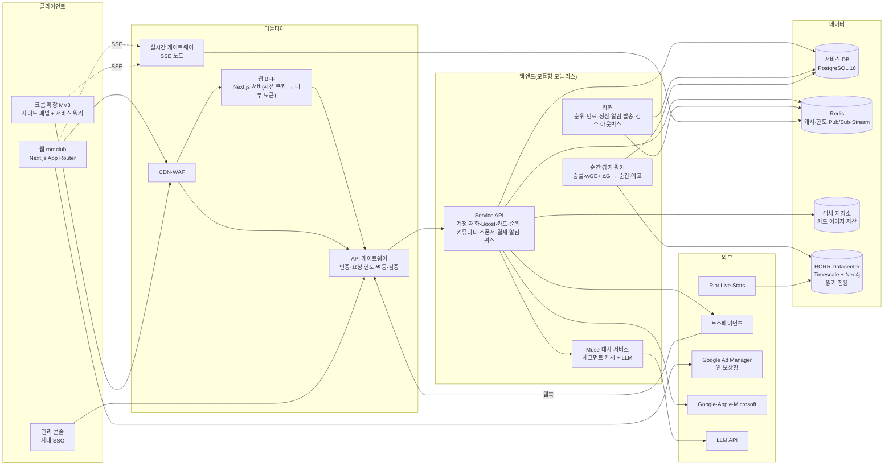

# 10. 시스템 아키텍처 (프론트엔드 · 미들티어 · 백엔드)

- 작성일: 2026-10-17
- 상태: **권장안** — 기술 선택은 CTO(Kazel) 확정 사항. 계약(API·스키마·이벤트)은 기술 선택과 무관하게 이 패키지 기준
- 계층별 상세: [15-frontend](15-frontend.md) · [16-middle-tier](16-middle-tier.md) · [17-backend](17-backend.md)

---

## 1. 전체 구성



## 2. 계층 책임

| 계층 | 책임 | 하지 않는 것 |
|---|---|---|
| **프론트엔드**(웹·확장) | 화면·상태 표시, 두 번 누르기·애니메이션, SSE 구독·알림 빈도 1차 판정, i18n, 접근성 | 차감·카드·배지·포인트·박스 결과 계산, 배분율 보유 |
| **미들티어** | 인증(쿠키·Bearer 통합), CSRF, 요청 한도, 멱등 키 저장·재생, 입력 스키마 검증, 응답 형식 통일, SSE 팬아웃·재전송 | 정책 판정(파트너 여부 등) |
| **백엔드** | 정책 판정, 트랜잭션(원장·Boost·카드·포인트), 결제·환불·정산, 순간 감지, 배치, 아웃박스 발행, 관리 기능 | 화면 문구 생성(고지 문구는 버전 테이블에서 제공) |
| **데이터** | 서비스 DB(정합성 기준), Redis(휘발), 객체 저장소, Datacenter(읽기 전용) | |

## 3. 권장 기술 (CTO 확정 필요)

| 영역 | 권장 | 이유 |
|---|---|---|
| 웹 | Next.js 15 App Router + TypeScript, Tailwind v4(토큰은 `tokens.css` 변수 연결), TanStack Query, Zustand(UI 상태), next-intl | 기존 포팅 결정(HANDOFF) |
| 확장 | MV3, React + Vite(CRXJS), 공용 UI 패키지, Three.js + @pixiv/three-vrm(동봉) | 확장 기획 04 |
| 공용 패키지 | `@rorr/tokens` `@rorr/ui`(카드·재화 선택·스테퍼·행운 박스 무대) `@rorr/api-client`(OpenAPI 생성) `@rorr/i18n` | 웹·확장 같은 렌더러(F-08 AC) |
| API | TypeScript(NestJS 또는 Fastify) 모듈형 모놀리스 | 팀 3~4명, 도메인 경계는 모듈로. 트래픽 확인 후 분리 |
| DB | PostgreSQL 16(서비스 DB 별도 인스턴스) | 원장 트랜잭션·제약. Datacenter와 분리(장애 격리) |
| 캐시·실시간 | Redis 7(Pub/Sub + Stream) | SSE 팬아웃·재전송 |
| 작업 큐 | 아웃박스 테이블 + 워커(BullMQ 또는 pg-boss) | 트랜잭션과 이벤트 원자성 |
| 인프라 | 컨테이너(서울 리전), 관리형 Postgres·Redis, CDN | 국내 결제·개인정보 |
| 관측 | OpenTelemetry → 로그·지표·추적, Sentry(웹·확장) | |

## 4. 저장소 구조 (모노레포 권장)

```
rorr/
  apps/
    web/              Next.js (rorr.club) — BFF 라우트 포함
    extension/        MV3 사이드 패널·서비스 워커
    admin/            관리 콘솔
    api/              Service API (모듈형 모놀리스)
    realtime/         SSE 게이트웨이
    workers/          배치·아웃박스·순간 감지·알림 발송
  packages/
    tokens/           handoff/tokens/tokens.css·json
    ui/               공용 컴포넌트(카드·재화 선택·스테퍼·행운 박스 무대·고지)
    api-client/       openapi.yaml → 타입·클라이언트 생성
    i18n/             KO·EN 키(웹 KO 사전 + 확장 i18n-ko.json에서 이관)
    domain/           공용 타입·상수 이름(값은 서버 설정)
  db/
    migrations/       schema.sql을 마이그레이션 단위로 분할
    tests/            test_boost.sql · test_luckybox.sql
```

## 5. 비기능 요구

| 항목 | 목표 |
|---|---|
| Boost 응답 | p95 300ms 이하(서버), 두 번째 누름 → 연출 시작 500ms 이하 |
| 큰 순간 예고 전달 | 순간 감지 → 클라이언트 표시 p95 2초 이하 |
| SSE 동시 연결 | 결승 기준 10만 연결 설계(노드당 2만, 수평 확장) |
| 가용성 | 경기 시간대 99.9%. 결제·원장 장애 시 Boost 차단(부분 성공 금지) |
| 정합성 | 원장 합 = 묶음 잔량 합(일 1회 대사 배치, 불일치 알림) |
| 보안 | 결제·토큰 비밀은 비밀 관리자, PII 최소화, 관리 기능 사내망 + SSO + 감사 기록 |
| 개인정보 | 팀 제공 데이터는 집계만, 최소 인원 미만 그룹 금지 |
| 접근성 | WCAG 2.2 AA(08 문서) |

## 6. 단계별 구축 순서

| 단계 | 범위 | 완료 기준 |
|---|---|---|
| 1 | 인증·계정·응원 팀, 서비스 DB, 미들티어(인증·멱등·한도) | 웹·확장 같은 계정 로그인 |
| 2 | 재화 원장, 충전(토스)·웹훅, 지갑 화면 | 결제 → 유료 묶음 → 잔액 표시 |
| 3 | 순간 감지 워커(datacenter 연동)·SSE, 큰 순간 알림 | 라이브 경기에서 예고 p95 2초 |
| 4 | Boost·카드·배지·포인트(`reference_boost.sql` 동등), 순위 스냅샷 | 테스트 27건 통과 + E2E |
| 5 | 광고 월, 메시지·검수, 알림함·동의 | |
| 6 | 확장(매칭·지연 보정·퀴즈·내 선수) | 확장 QA 체크리스트 |
| 7 | 환불·정산·공개 배분액, 스폰서 행운 박스(계약 시) | 정산 대사, 박스 테스트 10건 |
