# 11. 플로차트

- 작성일: 2026-10-17 · 형식: Mermaid(GitHub에서 바로 렌더, 전체 렌더 검증 완료)
- 상태 기계(화면 단위)는 [14-interaction-spec](14-interaction-spec.md)

| # | 흐름 | 종류 |
|---|---|---|
| F-1 | 사용자 여정 전체 | 흐름도 |
| F-2 | Boost 서버 판정 | 흐름도 |
| F-3 | Boost 요청 전 구간 | 시퀀스 |
| F-4 | 큰 순간 알림 표시 판정 | 흐름도 |
| F-5 | 스폰서 행운 박스 | 시퀀스 |
| F-6 | Energy 부족 → 충전 → 복귀 | 시퀀스 |
| F-7 | 충전 결제(토스페이먼츠) | 시퀀스 |
| F-8 | 환불 | 흐름도 |
| F-9 | 광고 월 Spark | 시퀀스 |
| F-10 | 로그인(웹·확장) | 시퀀스 |
| F-11 | 확장 경기 매칭·지연 보정 | 흐름도 |
| F-12 | 확장 퀴즈 스트릭 | 시퀀스 |
| F-13 | 기념 에디션 | 흐름도 |
| F-14 | 응원 메시지 검수 | 흐름도 |
| F-15 | 알림함 발송 판정(§5-7) | 흐름도 |
| F-16 | 월 정산·배분액 공개 | 흐름도 |

---

## F-1. 사용자 여정 전체

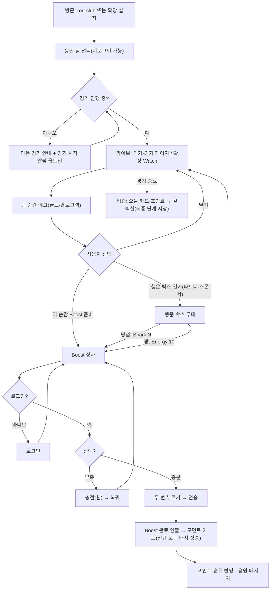

## F-2. Boost 서버 판정

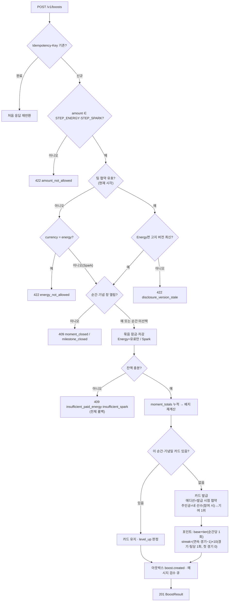

## F-3. Boost 요청 전 구간

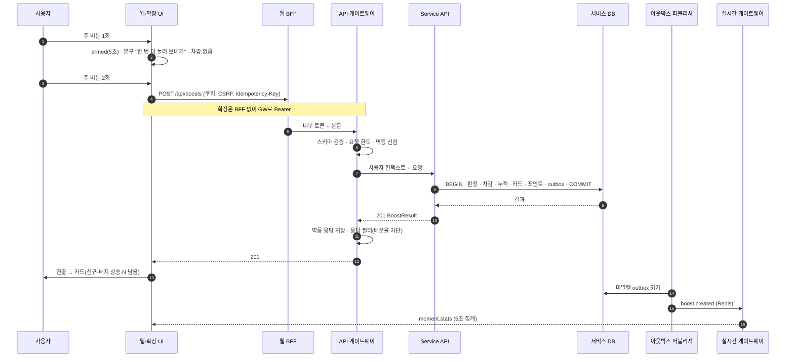

## F-4. 큰 순간 알림 표시 판정 (클라이언트)

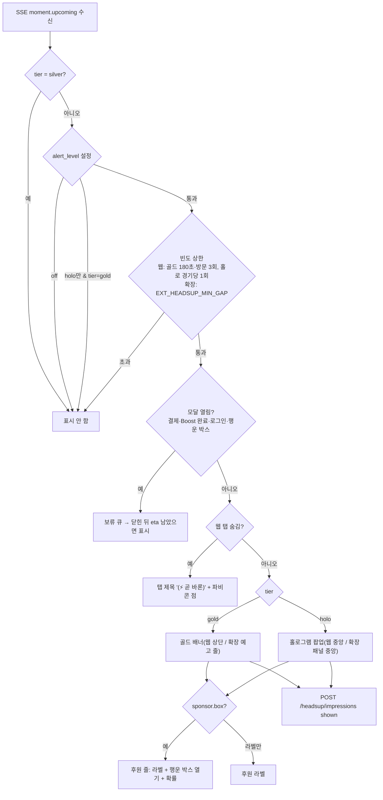

## F-5. 스폰서 행운 박스

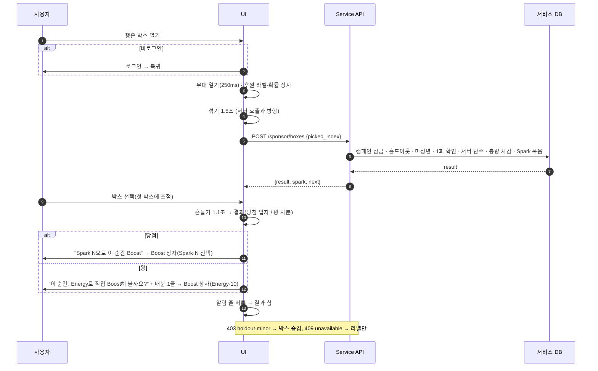

## F-6. Energy 부족 → 충전 → 복귀

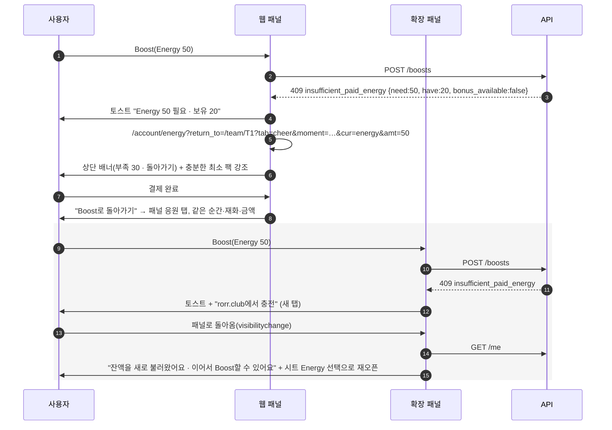

## F-7. 충전 결제

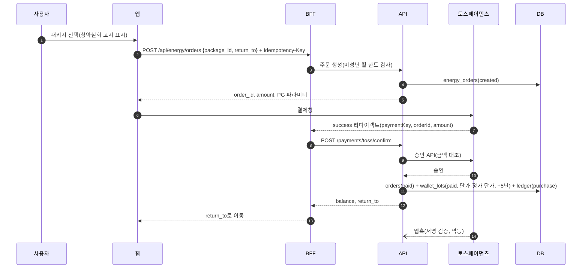

## F-8. 환불

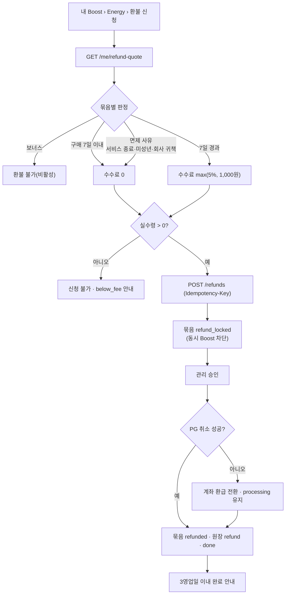

## F-9. 광고 월 Spark (웹)

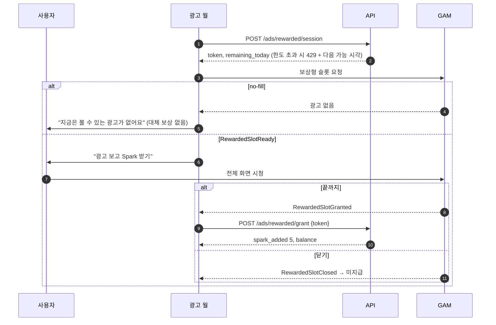

## F-10. 로그인

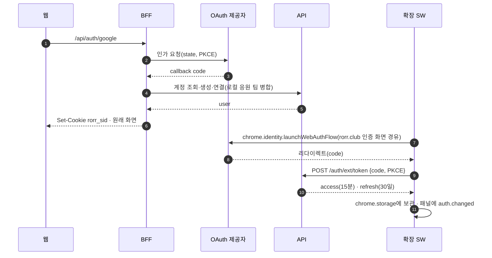

## F-11. 확장 경기 매칭·지연 보정

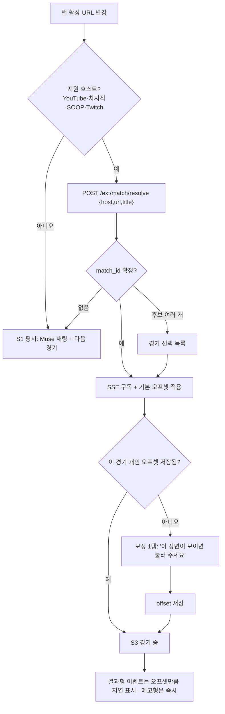

## F-12. 확장 퀴즈 스트릭

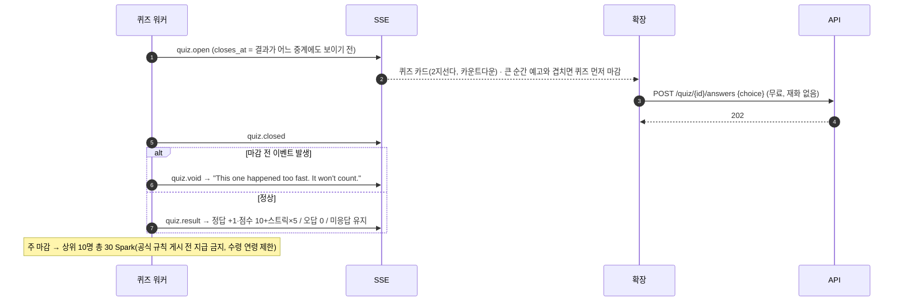

## F-13. 기념 에디션

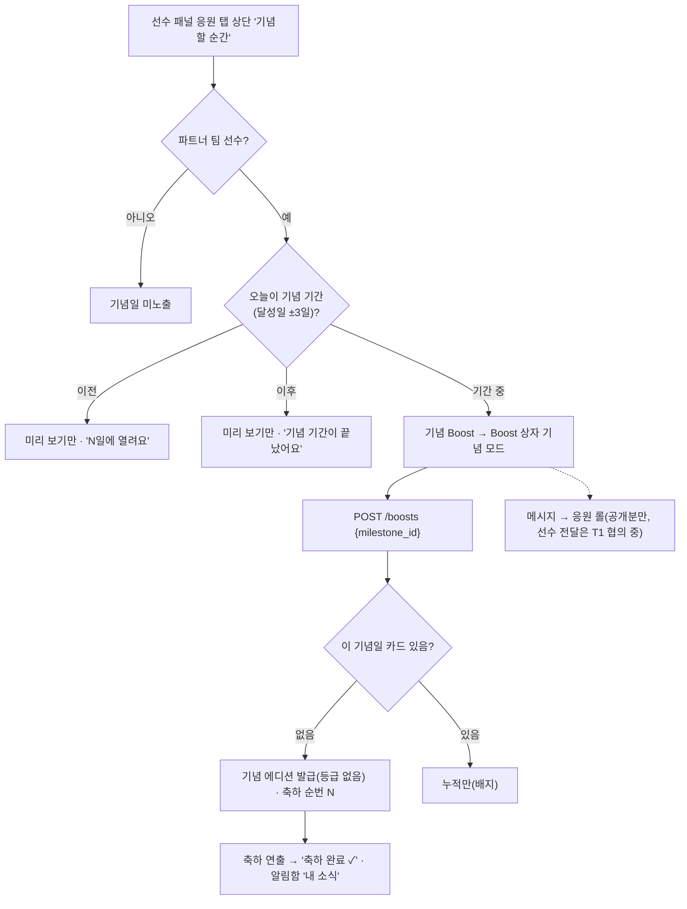

## F-14. 응원 메시지 검수

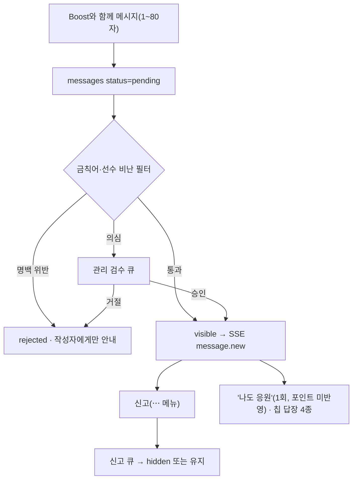

## F-15. 알림함 발송 판정 (정책 §5-7)

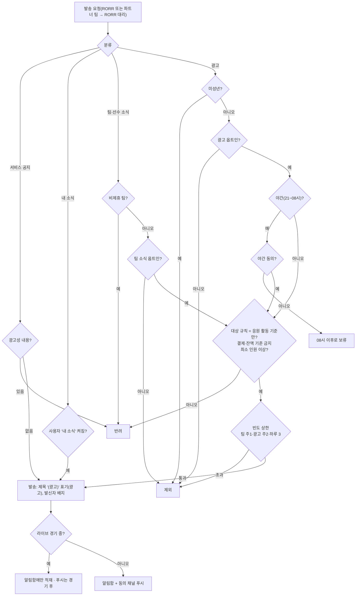

## F-16. 월 정산·배분액 공개

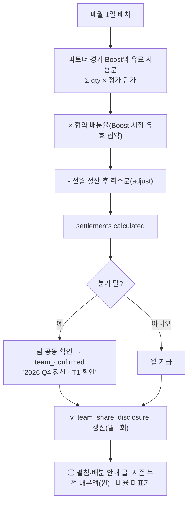
