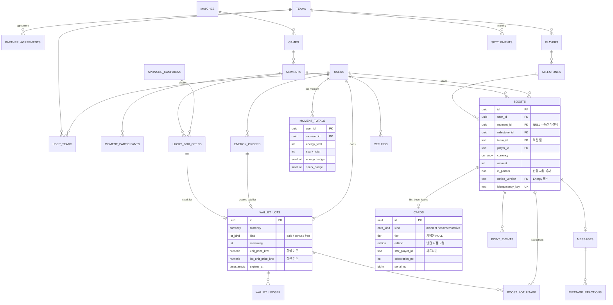

# 13. 스키마 정의

- 작성일: 2026-10-17
- DDL 원본: [`db/schema.sql`](db/schema.sql) — PostgreSQL 16, 테이블 52개·뷰 4개·트리거 3개
- 참조 구현: [`db/reference_boost.sql`](db/reference_boost.sql) · [`db/reference_luckybox.sql`](db/reference_luckybox.sql)
- 테스트: [`db/test_boost.sql`](db/test_boost.sql)(27건) · [`db/test_luckybox.sql`](db/test_luckybox.sql)(10건) — 모두 통과(§6)

---

## 1. 저장소 구성

| 저장소 | 내용 | 비고 |
|---|---|---|
| **서비스 DB**(이 스키마) | 계정·재화·Boost·카드·포인트·메시지·스폰서·결제·정산·퀴즈 | 신규. 트랜잭션 정합성 기준 |
| RORR Datacenter — Postgres/Timescale | 경기 원천 시계열(프레임·전투 이벤트·승률) | 기존. 서비스는 **읽기 전용**으로 순간 감지 워커만 접근 |
| RORR Datacenter — Neo4j | 선수·팀 관계 집계 | 기존. 통계 화면·Ask 근거 |
| Redis | 세션 캐시·요청 한도·SSE 팬아웃·재전송 버퍼·순위 캐시 | 휘발 허용 데이터만 |
| 객체 저장소 | 카드 공유 이미지·선수 사진(구단 제공)·스폰서 마크 | CDN |

- 서비스 DB와 datacenter의 조인 키는 `matches.source_ref`·`games.source_ref`. datacenter 쪽 game 테이블·참가자→선수 매핑이 아직 없음(데이터센터 검토 P0) → 수집 워커가 서비스 DB에 `games`·`moment_participants`를 직접 적재

## 2. ERD (핵심)



## 3. 도메인별 테이블

| 도메인 | 테이블 | 핵심 제약·불변식 |
|---|---|---|
| 설정 | `app_config` | 정책 §8 미정 값. 코드 상수 금지 |
| 계정 | `users` `auth_identities` `sessions` | 미성년(`age_band≠adult`)은 `show_in_highlights=false` 체크 제약 |
| 팀·선수·협약 | `leagues` `teams` `players` `partner_agreements` `user_teams` `user_favorite_players` | 협약 기간 중복 금지(EXCLUDE). 대표 팀 사용자당 1개(부분 유니크). **배분율은 이 테이블에만** |
| 경기·순간 | `matches` `games` `moments` `moment_participants` `milestones` | 순간 게임 내 `moment_key` 유일. 순간당 주인공 1명. 기념 기간 `celebrate_window` |
| 재화 | `energy_packages` `energy_orders` `wallet_lots` `wallet_ledger` `v_wallet_balance` | 원장 append-only(트리거). Energy 묶음은 paid/bonus, Spark는 free. 보너스·Spark 단가 0. 패키지 할인 0~10% |
| Boost | `legal_notice_versions` `boosts` `boost_lot_usage` `moment_totals` | 비제휴+Energy 금지(체크 + 협약 재확인 트리거). Energy는 고지 버전 필수. **보너스 묶음 사용 금지 트리거**(v1.3). 멱등 키 사용자당 유일 |
| 카드·포인트 | `cards` `v_card_with_badges` `point_events` `cheer_streaks` | 사용자·순간당 카드 1장, 사용자·기념일당 1장. 비제휴 카드에 선수 금지. 포인트 `dedup_key` 유일(순간당 1회) |
| 커뮤니티 | `messages` `message_reactions` `message_replies` `message_reports` | 본문 1~80자. 반응 1인 1회. 답장은 칩 4종만 |
| 순위 | `ranking_snapshots` | 5분 배치. "내 주변" 인덱스 |
| 광고 | `ad_sessions` | 토큰 1회용 |
| 스폰서 | `sponsors` `sponsor_campaigns` `sponsor_holdout` `lucky_box_opens` | 사용자·순간당 1회. 결과-수량 일치 체크. 총량 초과 금지. 확률표 버전 기록 |
| 알림 | `alert_impressions` `consent_records` `v_current_consent` `match_alert_subscriptions` `inbox_messages` `inbox_deliveries` | 광고 메시지 제목 "(광고)" 시작, 서비스 공지에 광고 금지. 경기 시작 알림 사용자·팀당 한 채널 |
| 결제·정산 | `refunds` `settlements` `v_team_share_disclosure` | 환불 실수령 > 0. 정산 월 1일 고정. 공개 뷰는 집계액만(비율 없음) |
| 퀴즈(확장) | `quiz_questions` `quiz_answers` `quiz_streaks` `quiz_weekly_results` | 선택지 2개. 1인 1응답 |
| 장식 | `deco_items` `deco_purchases` | 팀 장식은 팀 필수. 같은 아이템 1회 구매 |
| 인프라 | `idempotency_keys` `outbox_events` `admin_audit` | 미들티어·아웃박스·감사 |

## 4. 핵심 불변식 (테스트로 고정)

| # | 불변식 | 강제 위치 | 테스트 |
|---|---|---|---|
| I-1 | 같은 사용자·같은 순간 카드는 1장 | 부분 유니크 인덱스 | T2 |
| I-2 | 같은 순간 재Boost는 포인트 0, 배지만 상승 | `dedup_key` 유니크 + 참조 함수 | T2 |
| I-3 | 배지는 재화별 따로(합산 금지) | `moment_totals` 두 컬럼 | T3 |
| I-4 | 같은 멱등 키는 1회만 차감 | `UNIQUE(user_id, idempotency_key)` | T4 |
| I-5 | 비제휴 팀 Energy 금지 | 체크 제약 + 트리거 + 함수 | T5 |
| I-6 | 비제휴 카드에 선수 정보 없음 | 체크 제약 | T6 |
| I-7 | 닫힌 순간 Boost 거절 | 함수 | T7 |
| I-8 | 보너스 Energy는 Boost 불가, 실패 시 전체 롤백 | 트리거 + 함수 | T8 |
| I-9 | Energy Boost는 고지 버전 기록 필수 | 체크 제약 | T10 |
| I-10 | 기념 에디션은 등급 없음·기념일당 1장·축하 순번 | 체크 + 함수 | T11 |
| I-11 | 원장 수정·삭제 불가 | 트리거 | T12 |
| I-12 | 정산 근거는 유료 사용분만 | `boost_lot_usage` + 함수 | T13 |
| I-13 | 행운 박스 순간당 1회·총량·미성년·홀드아웃 | 유니크 + 함수 | 박스 10건 |

## 5. 운영 메모

- **배치**: 순위 스냅샷 5분 / 경기 종료 시 연속 응원 초기화(응원 팀 경기에 Boost 없으면 `current=0`) / 만료(유료 5년·보너스 1년·Spark 시즌 말 → 원장 `expire`) / 월 정산 / 2년 동의 재확인 대상 추출
- **파티션**: `wallet_ledger`·`point_events`·`alert_impressions`·`outbox_events`는 월 단위 파티션 권장(출시 후 6개월 내)
- **보존**: 결제·환불·원장·고지 노출 기록 5년(전자상거래법) / 메시지 신고 처리 기록 1년 / 탈퇴 시 개인정보 파기·원장은 가명 처리 후 보존 — 법률 확인 필요
- **개인정보**: 팀에 개인 단위 데이터 제공 금지(집계만). `ad_sessions.ip_hash`는 솔트 해시
- **서비스 플로우 v2 대비 변경**: ① `energy_lots` → `wallet_lots`(Spark 포함 통합, 정가 단가 컬럼 추가) ② `moment_totals` 신설(배지 누적) ③ `cards.deco_level` 제거 → `moment_totals`에서 조회 ④ Boost 차감 순서 "보너스 먼저" → **유료만**(v1.3) ⑤ 기념 에디션·행운 박스·알림함·동의·퀴즈·장식 테이블 신설 ⑥ `partner_agreements`의 배분율 기본값 제거

## 6. 검증 기록 (2026-10-17)

```
PostgreSQL 16.13 — schema.sql: 테이블 52 · 뷰 4 생성, 오류 0
test_boost.sql:     ok 27 · ALL BOOST TESTS PASSED
test_luckybox.sql:  ok 10 · ALL LUCKY BOX TESTS PASSED
```

- 실행: `psql -v ON_ERROR_STOP=1 -d <db> -f schema.sql -f reference_boost.sql -f reference_luckybox.sql -f test_boost.sql -f test_luckybox.sql` (테스트는 트랜잭션 안에서 실행 후 롤백)
