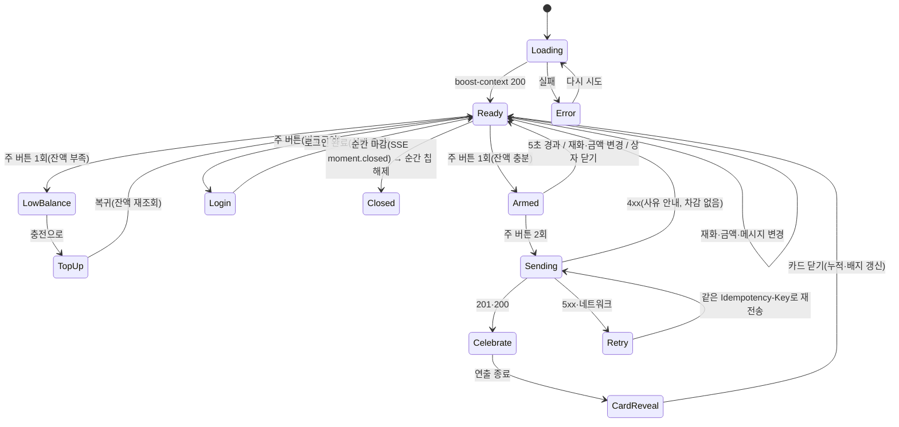
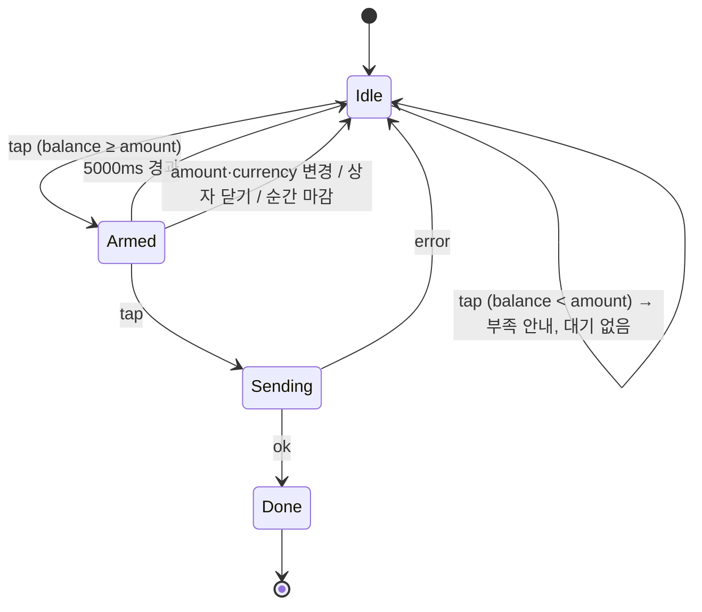
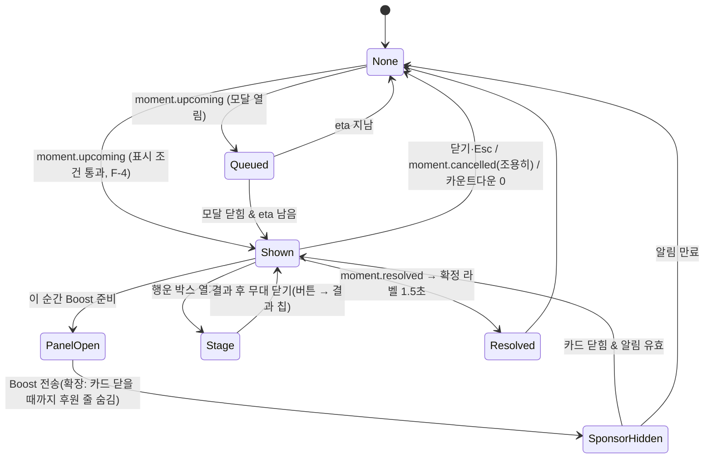
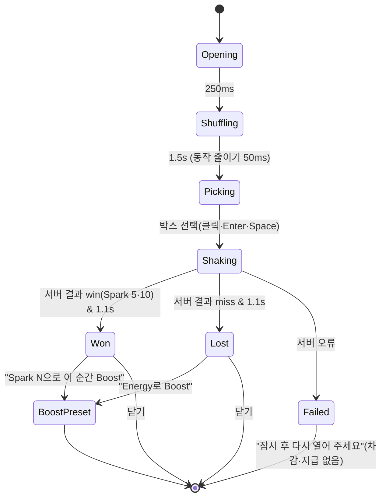
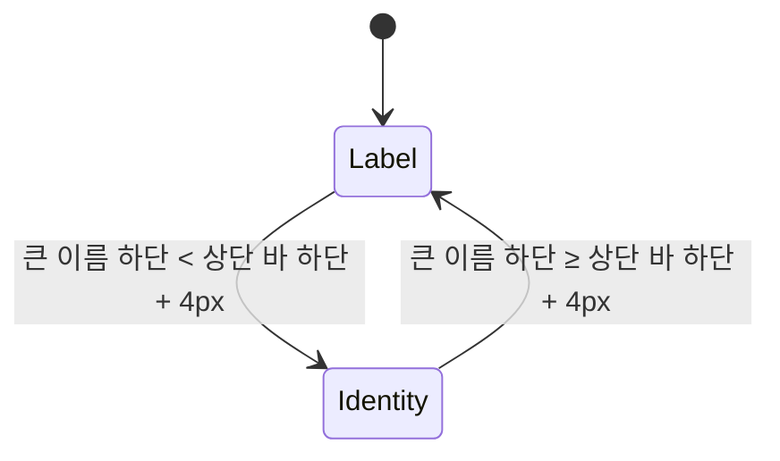
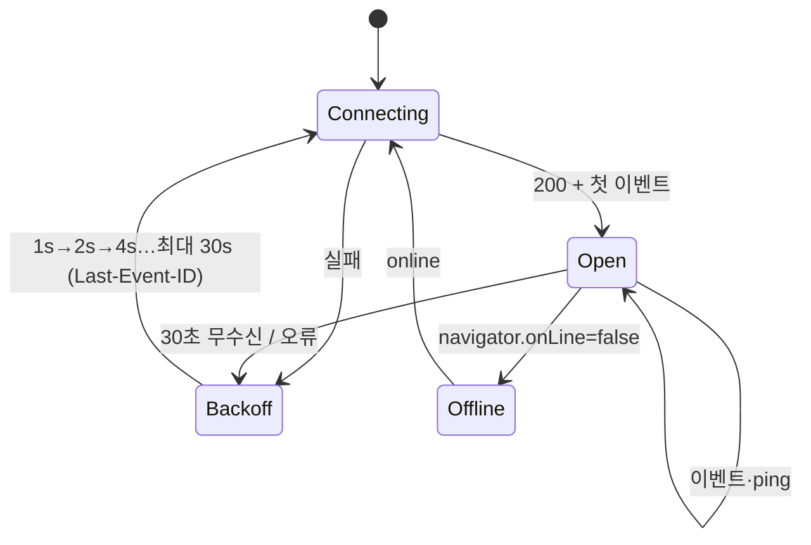
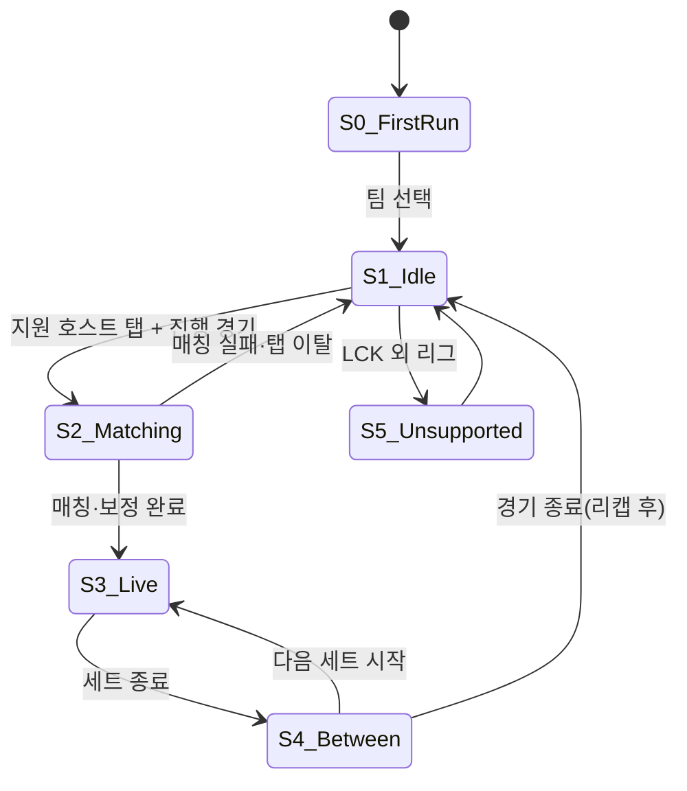

# 14. 인터랙션 정의 (상태 기계 · 이벤트 → 화면)

- 작성일: 2026-10-17
- 표기: 상태도는 Mermaid `stateDiagram-v2`. 각 표의 "트리거"는 사용자 입력·서버 응답·SSE 이벤트·타이머
- 시간·이징 값은 05 §6, 토큰은 `tokens.css` §8

---

## 1. Boost 상자 (웹 패널·확장 시트 공통)

| 상태 | 화면 | 접근성 |
|---|---|---|
| Ready | 대상 줄·재화·메시지·스테퍼·주 버튼 "{아이콘} Boost {N}"·단계 안내·차감 줄·고지 | 주 버튼 `aria-label` "Energy 10 Boost 보내기" |
| Armed | 주 버튼 "한 번 더 눌러 보내기 · {N}" + 테두리 타이머 링 5초, 안내 줄 "5초 안에 한 번 더 누르면 보내요. 아직 차감되지 않았어요." | `aria-label` 교체, 링은 `aria-hidden` |
| LowBalance | 웹: 토스트(필요·보유) / 확장: 토스트 + 충전 링크. 보너스만 있으면 "Boost에는 유료 Energy만 쓸 수 있어요" | 토스트 `aria-live=polite` |
| Sending | 주 버튼 진행 표시·비활성, 3초 초과 시 "조금 걸리고 있어요" | `aria-busy=true` |
| Celebrate | 웹 전체 화면 컷인 / 확장 패널 입자. 재Boost는 0.85초 축약 "한 번 더 응원!" | 동작 줄이기: 컷인 생략, 카드로 바로 |
| CardReveal | 신규: 카드 등장 / 재Boost: 카드 + "Energy 누적 20 · 2단계까지 30 남음" / 단계 상승: 칩 "배지 2단계!" | 카드 제목 낭독 |

- **사전 선택(preset)**: 행운 박스 결과·선수 칩·알림에서 들어오면 재화 라디오 `checked`·강조 클래스·주 버튼 문구·스테퍼 값을 **한 번에** 갱신(부분 갱신 금지 — b474590 버그)
- 재화 변경 시 금액은 그 재화 기본값(Energy 10 / Spark 10)으로, Armed 해제

## 2. Boost 주 버튼 (두 번 누르기)

## 3. 큰 순간 알림

| 요소 | 규칙 |
|---|---|
| 카운트다운 | 서버 `eta_at` − (현재 + 서버 시각 보정). 0이면 알림 종료 |
| 주 버튼 대상 | 순간 참여 즐겨찾기 선수 → 그 선수 패널, 없으면 응원 팀 패널. 순간·재화·금액 이어받기 |
| 후원 줄 | 순간 제목 아래 1px 선 위. 라벨 상시. 박스 연 뒤 결과 칩 |
| 초점 | 알림이 초점을 빼앗지 않음. 홀로그램 팝업도 `alertdialog`지만 자동 초점 이동 없음 |

## 4. 행운 박스 무대

- 서버 요청은 Opening 시점에 시작 — Shaking 종료까지 결과가 없으면 Shaking을 최대 2초 연장, 그래도 없으면 Failed
- 박스 3개는 `role="radio"` 그룹, ←→ 이동. 결과 문장 `aria-live=assertive` 1회
- 무대 전 구간: 상단 스폰서 마크 + "후원 · presented by {스폰서}", 하단 확률 문구, "어느 박스든 확률은 같아요"

## 5. 패널 축소형 헤더

- 감시: `IntersectionObserver`(rootMargin = 상단 바 높이) 권장. 원본은 scroll 이벤트
- Identity 진입 시 200ms 떠오름, 동작 줄이기면 즉시

## 6. 카드 공개

| 조건(BoostResult) | 표시 |
|---|---|
| `card.is_new` | 카드 등장(등급 테두리) + "모먼트 카드를 받았어요" |
| `!is_new && level_up` | 기존 카드 + 도장 장면 "Energy 배지 2단계!" |
| `!is_new && !level_up` | 기존 카드 + "Energy 누적 20 · 2단계까지 30 남음"(최고 단계면 "최고 단계") |
| `card = null`(순간 미선택) | 축약 연출 + "응원을 보냈어요" |
| `card.kind = commemorative` | 기념 틀 + "412번째 축하" → "축하 완료 ✓" |
| 확장 `star_reason` | fav_in_play: "내 선수 {P}의 순간" / fav_not_in_play: "이번엔 {top}의 순간이었어요 · {fav}는 이 교전에 없었어요" / auto: "가장 크게 기여한 선수 · {top}" |

## 7. 실시간 연결

- Offline: 상단 오프라인 바, Boost 비활성, 라이브 해설 "일시 정지 · 마지막 갱신 {시각}"

## 8. 확장 패널 상태 (S0~S5)

- S3 진입 시 그 팀의 `my_players` 키가 없으면(아직 안 물음) 퀴즈 자리에 "오늘 누구 응원해?" 카드(5명 + 자동으로 둘게요) → `PUT /me/my-player`
- S4에서만 "웹에서 Spark 받기" 노출(경기 중 광고 유도 금지)

## 9. 이벤트 → 화면 반응 표

| 입력 | 웹 | 확장 |
|---|---|---|
| SSE `score` | 티커·경기 페이지 숫자 | 매치 스트립(지연 보정) |
| SSE `moment.upcoming` | 배너/팝업(F-4) | 예고 줄/패널 중앙 + Muse 감정 tense |
| SSE `moment.open` | 패널 "지금 이 순간" 칩, 선수 칩 갱신 | Boost CTA 활성 |
| SSE `moment.resolved` | 확정 라벨 | 순간 플래시 "BARON STOLEN — T1" + Muse hype |
| SSE `moment.closed` | 순간 칩 해제, Armed 해제 | 같음 |
| SSE `moment.stats` | "함께 Boost 중 n" | 같음 |
| SSE `sponsor.pool{box:false}` | 박스 버튼 숨김 | 같음 |
| SSE `quiz.*` | — | 퀴즈 카드 |
| SSE `match.status` | 경기 페이지 상태 | S3/S4/S1 전환 |
| `visibilitychange: visible` | 탭 신호 원복 | 잔액 재조회(충전 복귀) |
| 409 insufficient_* 응답 | 충전 이동 + 복귀 배너 | 토스트 + 웹 링크 |
| 409 `moment_closed` | "마감됐어요" + 순간 해제 | 같음 |
| `prefers-reduced-motion` | 반복·장식 정지, 전환 단축 | 같음 |
