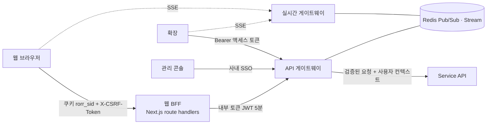
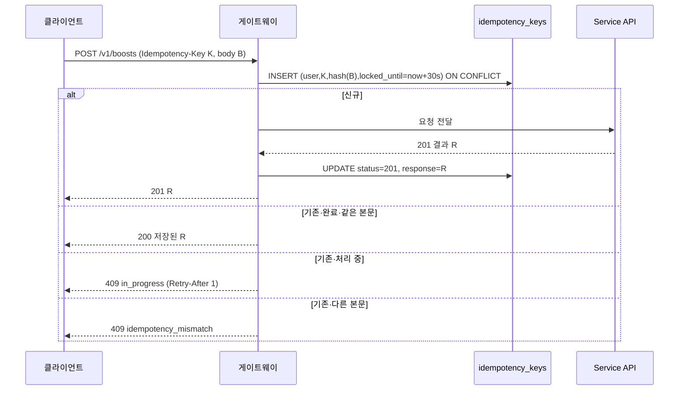

# 16. 미들티어 설계 (BFF · API 게이트웨이 · 실시간 게이트웨이)

- 작성일: 2026-10-17
- 역할: 클라이언트와 백엔드 사이의 **공통 관문**. 정책 판정은 하지 않고, 인증·보호·형식·실시간 전달을 책임진다

---

## 1. 구성

## 2. 웹 BFF

| 기능 | 규칙 |
|---|---|
| 세션 | 로그인 시 HttpOnly·Secure·SameSite=Lax 쿠키 `rorr_sid`(세션 ID). 서버 세션 저장소(Redis) → 사용자 ID |
| CSRF | 상태 변경(POST·PUT·PATCH·DELETE)은 `X-CSRF-Token`(더블 서브밋) 필수 |
| 내부 토큰 | BFF가 게이트웨이 호출 시 5분 만료 내부 JWT(`sub`, `client=web`, `age_band`) 발급 |
| SSR 데이터 | 서버 컴포넌트는 BFF 내부 호출로 `me`·경기 목록을 미리 채움(캐시 태그 무효화) |
| OAuth | `/api/auth/{provider}/callback` → 계정 연결·세션 생성 → 원래 화면으로 |
| 결제 리다이렉트 | `/api/payments/toss/success|fail` → 게이트웨이 `confirm` 호출 → `return_to`로 이동(허용 경로 목록만) |

## 3. API 게이트웨이

| 기능 | 규칙 |
|---|---|
| 인증 | 쿠키(BFF 경유 내부 토큰)·Bearer(확장)·SSO(관리)를 하나의 **사용자 컨텍스트**(`user_id`, `client`, `age_band`, `session_id`)로 통일해 백엔드에 전달 |
| 토큰 갱신 | 확장 액세스 15분·리프레시 30일(회전 + 재사용 감지 시 세션 전체 폐기) |
| 입력 검증 | `openapi.yaml` 스키마로 요청 검증 → 실패 422 `invalid_request`(필드 목록) |
| 멱등 | 대상 POST에서 `Idempotency-Key` 필수. `idempotency_keys`(user, key) 선점 → 처리 중이면 409 `in_progress`, 완료면 저장 응답 재반환, 본문 해시 다르면 409 `idempotency_mismatch`. 24시간 보관 |
| 요청 한도 | Redis 토큰 버킷 — 12 §5 표. 초과 시 429 + `Retry-After` |
| 응답 형식 | 오류는 `{error:{code,message,details,request_id}}`로 통일. 백엔드 예외 메시지(SQL 등) 노출 금지 |
| 버전 | 경로 `/v1`. 클라이언트 헤더 `X-Client`의 최소 버전 미달 시 426 `upgrade_required`(확장 강제 업데이트) |
| 응답 필터 | **배분율·내부 원가·다른 사용자 PII 필드 차단 목록**을 응답 직렬화 단계에서 제거(이중 안전장치) |
| 관측 | `X-Request-Id` 발급·전파, 경로·코드·지연 지표, 추적 헤더 |
| 보안 | WAF(봇·IP 평판), 결제 웹훅은 토스 서명 검증 + IP 허용 목록, 관리 API는 사내망 + SSO + 2단계 인증 |

### 3-1. 멱등 처리 순서

- 백엔드도 `boosts(user_id, idempotency_key)` 유니크로 한 번 더 막는다(게이트웨이 저장 실패 대비)

## 4. 실시간 게이트웨이 (SSE)

| 항목 | 규칙 |
|---|---|
| 연결 | `GET /v1/live/stream?match_ids=` — 비로그인 허용, IP당 5개 |
| 팬아웃 | Redis Pub/Sub `live:{match_id}` 구독 → 연결별 필터(구독 경기) → 전송 |
| 재전송 | `Last-Event-ID` → Redis Stream `live-buf:{match_id}`(최근 2분)에서 재생. 범위 밖이면 `snapshot` |
| 하트비트 | 15초 `: ping` |
| 확장 | 패널 열림 동안만 연결(서비스 워커 종료 전제). 닫힌 상태의 배지는 재연결 시 `snapshot.alert`로 판단 |
| 수평 확장 | 상태 없는 노드, 로드밸런서 연결 고정 불필요(재연결 시 재생) |
| 개인 데이터 | 싣지 않음(잔액·카드는 REST로만) |
| 백프레셔 | 클라이언트 버퍼 초과 시 연결 종료 → 클라이언트 재연결 + `snapshot` |

## 5. 캐시

| 대상 | 위치 | 만료 |
|---|---|---|
| 경기 목록·상세 | CDN(공개) + Redis | 라이브 5초 / 그 외 60초 |
| `boost-context` | 클라이언트(Query) | 순간 열림 5초 / 그 외 30초, SSE `moment.closed`로 무효화 |
| 순위 | Redis(스냅샷 단위) | 다음 스냅샷까지 |
| 카드 이미지 | 객체 저장소 + CDN | 불변(카드 ID·배지 단계 키) |
| `me` | 캐시 안 함 | — |
