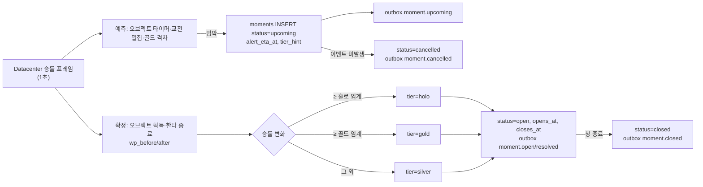

# 17. 백엔드 설계

- 작성일: 2026-10-17
- 구조: 모듈형 모놀리스(Service API) + 워커 + 순간 감지 워커. 도메인 모듈 간 호출은 모듈 공개 인터페이스로만, 비동기 연결은 아웃박스 이벤트로

---

## 1. 도메인 모듈

| 모듈 | 책임 | 주요 테이블 | 발행 이벤트 |
|---|---|---|---|
| identity | 계정·OAuth·세션·연령대·법정대리인 동의 | users, auth_identities, sessions | user.created |
| catalog | 리그·팀·선수·협약 조회, 파트너 판정 함수 `isPartner(team, at)` | teams, players, partner_agreements | — |
| live | 경기·세트·순간·기념일, 순간 상태 전이 | matches, games, moments, moment_participants, milestones | moment.upcoming/open/resolved/closed/void |
| wallet | 묶음·원장·잔액·만료, 차감 서비스 `spend(user, currency, qty, purpose)` | wallet_lots, wallet_ledger | wallet.changed |
| boost | Boost 트랜잭션(`reference_boost.sql`과 동등), 누적·배지 | boosts, boost_lot_usage, moment_totals | boost.created |
| cards | 카드 발급·조회·공유 이미지 렌더 | cards | card.issued |
| points | 포인트·연속 응원·순위 스냅샷 | point_events, cheer_streaks, ranking_snapshots | ranking.updated |
| community | 메시지·검수·반응·답장·신고 | messages, message_* | message.visible |
| sponsor | 캠페인·홀드아웃·행운 박스(`reference_luckybox.sql`과 동등) | sponsor_*, sponsor_box_opens | sponsor_box.opened |
| ads | 광고 월 토큰·보상 | ad_sessions | — |
| payments | 주문·토스 승인·웹훅·환불 | energy_orders, refunds | order.paid, refund.done |
| settlement | 월 정산·팀 확인·공개 배분액 | settlements | settlement.confirmed |
| notify | 동의·알림함·경기 시작 알림·발송 | consent_records, inbox_*, match_alert_subscriptions | — |
| quiz | 퀴즈 출제·마감·판정·주간 상금 | quiz_* | quiz.* |
| muse | 대사 세그먼트 캐시·Ask | (캐시) | — |
| admin | 설정·감사 | app_config, admin_audit | — |

## 2. 핵심 트랜잭션

### 2-1. Boost

1. 게이트웨이 멱등 선점 → `boost.send(ctx, req)`
2. 하나의 DB 트랜잭션(격리 수준 READ COMMITTED + 행 잠금):
   - 금액이 스테퍼 단계 값인지 → 파트너 판정 → 순간·기념 창 확인(+`BOOST_GRACE_MS`)
   - `boosts` 삽입 → 유료(또는 Spark) 묶음을 만료 빠른 순으로 `FOR UPDATE` 잠금·차감 → `boost_lot_usage` → `wallet_ledger`
   - `moment_totals` 갱신 → 배지 재계산 → 카드(없을 때만, 등급은 Boost 시점 값) → 포인트(dedup) → 연속 응원(첫 경기 0)
   - `BOOST_SETTLE_MODE=on_moment`면 `status=pending`·원장 `boost_hold`로 넣고 순간 확정 워커가 위 단계를 실행(성립 시 `boost.settled`, 불발 시 `boost_release` + `boost.voided`)
   - 메시지 있으면 `cheer_messages(status=pending)` → 검수 큐
   - `outbox_events('boost.created')`
3. 커밋 후 응답. 실패 시 전체 롤백(부분 차감 없음)
- 정답 동작: `db/reference_boost.sql`. 앱 코드로 구현할 경우 같은 입력으로 `db/test_boost.sql` 시나리오를 통합 테스트로 옮겨 통과시킬 것
- 동시성: 같은 사용자 동시 Boost는 묶음 행 잠금으로 직렬화. 같은 순간 카드 경합은 부분 유니크 인덱스가 최종 방어(충돌 시 기존 카드 반환)

### 2-2. 충전

```
POST /energy/orders → energy_orders(created) → 토스 결제창
→ success 리다이렉트 → POST /payments/toss/confirm(금액 대조) → 토스 승인 API
→ 트랜잭션: orders(paid, withdrawal_until) + wallet_lots(paid, unit_price=실결제/수량, list_unit_price=정가/수량, expires=+5년) + ledger(purchase)
→ 웹훅(중복 수신 멱등) 으로 상태 재확인
```

- 미성년 월 한도는 주문 생성 시 검사. 결제 취소 웹훅 → 미사용 묶음 취소, 사용분은 `settlements.adjust_krw`

### 2-3. 환불 (`docs/specs/refund.md` 그대로)

- 견적: 묶음별 `remaining × unit_price`, 7일 이내 수수료 0 / 이후 `max(5%, 1,000원)`, 면제 사유, 실수령 0 이하 신청 불가
- 신청: 대상 묶음 `refund_locked`(동시 Boost 차단) → 승인 → PG 취소(실패 시 계좌 환급) → 묶음 `refunded` + 원장 `refund`

### 2-4. 정산 (월 1회)

```sql
-- 팀별 월 정산 근거: Boost에 쓰인 유료 Energy × 정가 단가 (보너스·Spark·미사용·환불분 제외)
SELECT b.team_id, SUM(u.qty * u.list_unit_price_krw) AS gross_list_krw
FROM boosts b JOIN boost_lot_usage u ON u.boost_id = b.id
JOIN wallet_lots l ON l.id = u.lot_id AND l.kind = 'paid'
WHERE b.is_partner AND b.created_at >= :month_start AND b.created_at < :month_end
GROUP BY b.team_id;
```

- `team_share_krw = gross_list_krw × agreement.team_share_bp / 10000`(협약은 Boost 시점 유효분). 패키지 할인은 RORR 몫에서만 부담 → 정가 기준
- 분기 공동 확인 후 `team_confirmed` → `v_team_share_disclosure`가 공개 화면 데이터

## 3. 순간 감지 워커



- 등급 임계값은 설정값(확장 목업 기준 골드 ≥12%p·홀로그램 ≥30%p) — 실측 후 확정
- 참여 선수·기여도(`moment_participants`)는 같은 워커가 적재. **datacenter 참가자→선수 매핑이 없으므로** 수집 단계에서 매핑 테이블을 먼저 만든다(데이터센터 검토 P0)
- 예고 무산률·감지 지연을 지표로 기록

## 4. 배치·워커

| 작업 | 주기 | 내용 |
|---|---|---|
| 아웃박스 퍼블리셔 | 상시(폴링 200ms 또는 LISTEN/NOTIFY) | `outbox_events` → Redis Pub/Sub·큐, `published_at` 기록 |
| 순위 스냅샷 | 5분 | 팀·기간·기준별 순위(익명·미성년 제외 규칙 반영) |
| 연속 응원 초기화 | 경기 종료 시 | 응원 팀 경기에 Boost 없던 사용자 `current=0` |
| 만료 | 매일 04:00 KST | 만료 묶음 `expired` + 원장 `expire` |
| 원장 대사 | 매일 | Σ원장 = Σ묶음 잔량 확인, 불일치 알림 |
| 메시지 검수 | 상시 | 금칙어 필터 → 자동 통과/보류 → 관리 큐 |
| 알림 발송 | 예약 | 동의·빈도 상한·야간·미성년 규칙 검사 후 발송, 경기 중 푸시 보류 |
| 경기 시작 알림 | 시작 10분 전 | 구독 채널 1개로 발송 |
| 퀴즈 판정·주간 상금 | 이벤트·주 마감 | 판정 → 스트릭 → 주간 순위 → 상위 10명 Spark 지급(공식 규칙 게시 전 지급 금지) |
| 월 정산 | 매월 1일 | §2-4 |
| 동의 재확인 | 매일 | 2년 도래 대상 추출 |
| 카드 이미지 | 이벤트 | `card.issued` → 이미지 렌더(헤드리스) → 객체 저장소 |

## 5. 외부 연동

| 연동 | 방식 | 실패 처리 |
|---|---|---|
| 토스페이먼츠 | 결제창 → 승인 API → 웹훅(서명 검증) | 승인 실패 시 주문 `failed`, 웹훅 재시도 멱등 |
| GAM 웹 보상형 | 브라우저 이벤트 → 서버 1회용 토큰 검증(S2S 미지원) | no-fill 시 버튼 숨김, 대체 보상 금지 |
| OAuth | Google·Apple·Microsoft | 연결 해제 시 다른 로그인 수단 1개 이상 필수 |
| LLM | Muse 대사·Ask | 세그먼트 캐시 우선, 타임아웃 시 규칙 기반 대사 |
| Riot Live Stats | Datacenter 경유 | 지연 시 예고 생략(오예고보다 미예고) |

## 6. 관측·운영

- 지표: Boost 성공률·p95, 차감 실패 코드 분포, 예고 지연·무산률, SSE 연결 수, 행운 박스 홀드아웃 비교(그 순간 Energy Boost율·다음 큰 순간 Boost율·재방문율), 파트너 경기 Energy 비중(`partner_energy_share_floor`)
- 알림: 원장 대사 불일치, 웹훅 서명 실패, 순간 감지 지연 > 5초, 5xx 비율
- 감사: 관리 변경 전부 `admin_audit`, 설정 변경은 이전 값 보존
